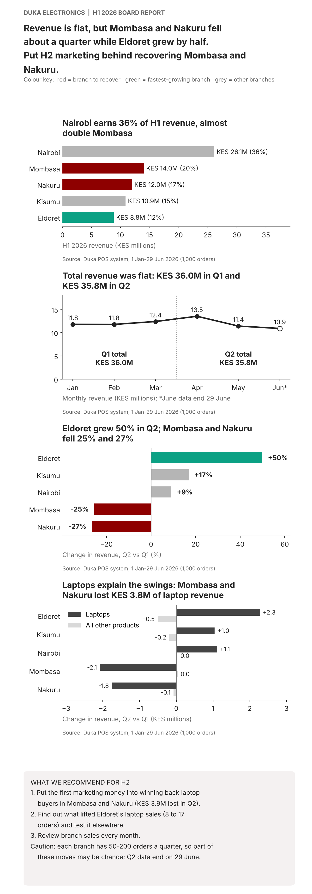

# PLP Data Analytics · Assignment 4: Student EDA and Board Report

Two engagements that show both halves of an analyst's job: finding the story and telling it.

## 1. Engagement summaries

**Engagement 1 · County education office (`student_eda.ipynb`).** An exploratory analysis of 1,200 students (seed 55) to show which learners are most at risk and what is associated with better results, structured as Structure, Univariate, Bivariate, Multivariate and Hypotheses, with Findings, Recommendations and Limitations. It adds `average_score` and `performance_band`, a correlation matrix, pivot tables testing the school-type gap, and a fitted trend line of score against study hours.

**Engagement 2 · Duka Electronics board (`board_report.ipynb`).** A storyboard (audience, decision, Big Idea, SCR) followed by a chart makeover (`figures/before.png`, `figures/after.png`) and a one-page, phone-friendly board report (`reports/duka_board_report.png`) built from the H1 2026 sales data (1,000 orders, seed 2026). A Looker Studio dashboard is described in `dashboard.md`.

## 2. How to run

```bash
pip install -r requirements.txt jupyter
python generate_data.py            # writes student_performance.csv and duka_sales.csv
jupyter nbconvert --to notebook --execute --inplace student_eda.ipynb
jupyter nbconvert --to notebook --execute --inplace board_report.ipynb
```

| Path | Contents |
|---|---|
| `generate_data.py` | Both generators, unchanged (student seed 55; Duka seed 2026) |
| `student_eda.ipynb` | Engagement 1 analysis |
| `board_report.ipynb` | Engagement 2 storyboard, makeover, report, board summary, dashboard export |
| `figures/` | Five EDA charts plus `before.png` and `after.png` |
| `reports/duka_board_report.png` (and `.pdf`) | The one-page board report |
| `duka_dashboard_data.csv` | Data prepared for Looker Studio |
| `dashboard.md` | Dashboard link, screenshots and build notes |

## 3. Five key EDA insights (county education office)

1. **8.2% of students (99 of 1,200) are At Risk** (average score below 60); 56.0% are Meeting and 35.8% are Exceeding. The typical student scores about 72.
2. **Study time is the strongest lever:** each extra weekly study hour is associated with about 2.1 more points (r = 0.70, R² = 0.50). The At Risk share is 21.2% in the lowest study quartile (up to 2.9 hours) and 0.3% in the highest.
3. **Attendance matters, less strongly:** r = 0.36; the At Risk share is 23.9% below 70% attendance against 2.6% above 85%.
4. **Public-school students are 7× as likely to be At Risk** (10.9% vs 1.5%). The 5.5-point score gap holds within every attendance band and study-hour quartile, so it is not explained by those two factors.
5. **County and gender do not separate learners:** the At Risk share ranges only from 6.4% (Nakuru) to 9.2% (Nairobi), a difference consistent with chance (p = 0.92), and male and female averages differ by 0.2 points.

**Recommendations**

1. **Target by behaviour, not by county or gender.** Enrol learners who study 2.9 hours a week or less (the lowest quartile) or attend fewer than 70% of days. This rule covers 39% of learners and captures **87% of all At Risk students**; the At Risk rate is 18.4% inside the group against 1.8% outside. Offer supervised study time and attendance follow-up as the core of the programme.
2. **Give public schools priority in the first phase, and measure why.** Their At Risk rate is about 7× higher. Because the data cannot say whether the cause is teaching, resources or home circumstances, collect household income, teacher ratios and prior-year results, and run the programme as a pilot with a comparison group before scaling.

## 4. One-page board report



## 5. Board Summary

Duka Electronics sold KES 71.8M in the first half of 2026, and Nairobi alone delivered 36% of it. Total sales were steady: KES 36.0M from January to March and KES 35.8M from April to June. Underneath, the picture changed. Eldoret grew by 50%, but Mombasa and Nakuru fell by about a quarter each, losing KES 3.9M between them. Almost all of that loss, KES 3.8M, came from fewer laptop sales, our biggest earner. Their combined loss is more than twice Eldoret's gain of KES 1.8M, and they are our second- and third-largest branches. We recommend that the second-half marketing budget first goes to winning back laptop buyers in Mombasa and Nakuru, and that we learn what Eldoret did right. One caution: each branch has only a few hundred orders, so part of these swings may be chance. We should review branch results every month.
